# MeshCore 102 Presenter Guide

## Build The People's Repeater

**Class length:** 2 hours  
**Recommended level:** MeshCore 102  
**Primary activity:** Convert a Harbor Breeze solar light into a solar-powered MeshCore repeater  
**Hands-on build time:** 65 minutes, including open-unit inspection and testing

This guide keeps the class moving while students use the separate Student Guide and Build Instructions. Complete the firmware and repeater configuration before disassembly so the supplied Wio antenna remains attached during computer setup. The finished repeater uses the ALFA outdoor antenna and does not retain the original light.

## Class Goals

By the end of the class, participants should be able to:

- Distinguish companions, repeaters, and Room Servers.
- Explain what a dedicated MeshCore repeater does.
- Identify the qualities of a useful repeater location.
- Assemble The People's Repeater using the supplied components.
- Configure, inspect, and perform basic radio and charging tests.
- Describe how to weatherproof, mount, and maintain the finished unit.

## Before the Class

### Prepare Reference Materials

- Assemble and test one finished repeater as a demonstration unit.
- Prepare one partially assembled unit that shows the internal component arrangement.
- Have the Student Guide and Build Instructions available in print or electronically.
- Project the repeater configuration, naming, county-code, MeshMapper, and solar-angle pages.
- Display a photograph of the completed repeater in its intended outdoor orientation.

### Prepare Computers and Firmware

- Confirm that every computer can flash and configure the XIAO nRF52840 and Wio-SX1262.
- Stage the current compatible MeshCore repeater firmware and USB cables.
- Leave the supplied small Wio antenna attached for firmware and configuration work.
- Keep at least one known-good USB cable and radio available for troubleshooting.
- Decide which legal regional preset and repeater class settings the class will use.
- Confirm that the NEIMesh radio, CLI, and region recommendations in this guide are still current before class.

### Prepare Each Kit

#### Electronics and Power

- Harbor Breeze solar light with included 1500 mAh 18650 battery
- Seeed Studio XIAO nRF52840 with Wio-SX1262 LoRa radio
- ACEIRMC CN3065 mini solar LiPo charger
- Three 100 mm female-socket JST PH 2.0 silicone-wire leads

The class JST leads have already been corrected by swapping the red and black positions where needed. Students must still verify actual polarity before making connections.

#### Antenna System

- ALFA Network AOA-915-5ACM 5 dBi outdoor 915 MHz antenna
- 6 in / 15 cm U.FL1-to-N-female RG178 pigtail
- Waterproof self-fusing silicone tape

The small antenna supplied attached to the Wio is used during pre-build setup only. It is disconnected once after configuration and is not used in the finished repeater.

#### Enclosure and Mounting

- 3D-printed TPU gasket
- 3D-printed PETG component mount
- 3D-printed PETG [antenna connector clamp](https://www.printables.com/model/1761740-xiao-nrf52840-wio-sx1262-antenna-clamp)
- Zip ties or hose clamps for attaching the mount to a pole

The [Harbor Breeze solar mesh-node models](https://www.printables.com/model/1748950-26-harbor-breeze-solar-mesh-node-mounts-meshtastic) page contains the component mount, alternate mounts, and TPU gasket.

### Prepare Tools and Supplies

- Soldering irons, stands, solder, and tip-cleaning supplies
- Flush cutters or wire cutters
- Multimeters
- Nonconductive tools for battery removal
- Small screwdrivers and tools for tightening the N-connector hardware
- Parts trays for retained screws and the separate mount nut
- Painter's tape
- Goo Gone, isopropyl alcohol, and cleaning cloths
- Computers and USB cables
- Completed reference repeater

### Perform Pre-Class Checks

- Confirm that all JST leads have been corrected, but do not treat wire color as proof of polarity.
- Check that the printed parts fit the enclosure and pigtail used in class.
- Confirm that every kit has the correct washers and N-connector nut.
- Arrange tables so the presenter or helpers can inspect solder joints and measurements.
- Set aside a troubleshooting area for units that need more time.

## Class Schedule

| Time | Presenter focus |
| ---: | --- |
| 0:00-0:15 | MeshCore refresher, Room Servers, and project overview |
| 0:15-0:30 | Placement and solar guidance |
| 0:30-0:45 | Firmware, repeater configuration, and naming |
| 0:45-1:50 | Guided construction and open-unit testing |
| 1:50-2:00 | Installation, maintenance, and wrap-up |

Protect the 65-minute build period. Move optional discussion to the end or to a follow-up session.

## 0:00-0:15 MeshCore Refresher and Project Overview

### Suggested Introduction

"Welcome back to The Maker's Space. Today we are building The People's Repeater, a solar-powered MeshCore repeater housed in a repurposed Harbor Breeze solar-light enclosure. We will configure the radio first, discuss placement, and then reserve the rest of the class for construction and testing. The finished unit has an outdoor antenna and no light."

### MeshCore Roles and Room Servers

- A **companion** gives a person access to the mesh.
- A **repeater** extends useful coverage by forwarding packets toward their destinations.
- A **Room Server** is a shared message board. It stores posts and can deliver unseen history when a user returns, unlike an ordinary channel where a message can be missed while the user is out of range.

A Room Server and repeater solve different problems. MeshCore recommends separate devices for the best experience; enabling repeat behavior on a Room Server does not provide the full repeater feature set. This class builds a dedicated repeater. See the [MeshCore FAQ](https://github.com/meshcore-dev/MeshCore/blob/main/docs/faq.md).

Show the completed reference unit. Identify the enclosure, panel, battery, XIAO and Wio boards, CN3065, printed parts, pigtail, ALFA antenna, TPU gasket, switch, weatherproofing, and pole-mounting points.

Mention that a larger-capacity compatible 18650 may provide more reserve during cold or low-sun months. Any replacement must match the required chemistry, voltage, size, polarity, terminal style, protection, and charger requirements.

## 0:15-0:30 Placement and Solar Guidance

### Key Message

**Height helps, but a useful location is more than simply the highest available point.** The goal is reliable radio coverage, adequate sunlight, safe access, and long-term survivability.

### 1. Start with the coverage objective

Ask:

- What area are we trying to serve?
- Are we filling a known dead zone?
- Are we connecting two groups or neighborhoods?
- Is there already good repeater coverage nearby?
- Who will benefit from this location?

Emphasize intentional placement. A repeater should solve a coverage problem or strengthen an important route through the mesh.

Use [MeshMapper](https://fwa.meshmapper.net/) to demonstrate the purpose and radio-path tools.

### 2. Favor clear radio paths

Discuss the advantages of:

- Greater elevation
- Open surroundings
- Fewer nearby walls, roofs, trees, and metal structures
- A position with a clear view toward the intended coverage area
- Keeping the antenna away from large metal objects

Explain that terrain and structures can block or weaken signals. A location that looks close on a map may still perform poorly when a hill, building, or dense obstruction lies between stations.

### 3. Protect antenna performance

Point out that the antenna should:

- Remain in the orientation intended by the design.
- Not be buried inside or pressed directly against metal.
- Be kept clear of wiring and other objects when possible.
- Have secure, weather-resistant connections.
- Not be bent, cut, substituted, or modified casually.

Use the demonstration unit to show the desired antenna position.

### 4. Plan for solar exposure

A solar repeater needs enough light to replace the energy it uses.

Look for:

- Reliable sunlight across the day
- Minimal seasonal shading
- A panel orientation that receives useful light
- A location that will not quickly become covered by leaves, vegetation, snow, or debris

In Indiana, a generally southerly exposure at approximately a 40° angle is a useful starting point, adjusted for site-specific shade. Demonstrate the [solar tilt-angle calculator](https://www.baess.app/tools/solar-tilt-angle-calculator).

Remind participants that a sunny location in November may be shaded differently during another season.

### 5. Consider weather and drainage

Choose a position that:

- Does not collect standing water
- Allows water to drain away from openings
- Keeps cable entries and seals in their intended orientation
- Avoids direct runoff from roofs or gutters
- Is not likely to be struck by lawn equipment, vehicles, or falling debris

Weather resistance depends on both sealing and orientation. An enclosure that survives ordinary rain may fail if installed upside down or where water continually pools against a seam.

### 6. Maintain safe, legal access

A suitable location should:

- Be installed with the property owner’s permission.
- Be safely reachable for inspection and repair.
- Not interfere with utilities or normal property use.
- Avoid creating a climbing, tripping, or falling-object hazard.
- Comply with any applicable property, mounting, and radio requirements.

### 7. Make maintenance possible

Every repeater will eventually need inspection.

Ask participants to consider:

- Can the unit be retrieved safely?
- Can the solar panel be cleaned?
- Can the battery be serviced?
- Can water intrusion or physical damage be noticed?
- Is there a way to identify the unit and its owner?
- Can its operation be checked without removing it?

### Placement checklist

Before installing a repeater, confirm:

- It serves a clear coverage purpose.
- The radio path is reasonably open.
- The antenna has adequate clearance.
- The solar panel receives useful sunlight.
- The enclosure can drain and resist weather.
- The mounting point is secure.
- Installation and maintenance are safe.
- The property owner has approved the installation.
- The repeater can be retrieved and inspected.

## 0:30-0:45 Firmware Configuration and Naming

Complete this section before anyone cuts a wire or opens an enclosure. Leave the supplied Wio antenna attached during setup.

Keep this section focused on firmware, required repeater settings, the name, and normal startup.

Naming standard: `StateCode.CountyCode.descriptiveName`.

- Allen County: `IN.ALL.descriptiveName`
- Local Fort Wayne convention: `IN.ALL.FWA.descriptiveName`
- [Repeater naming](https://docs.okimesh.org/books/meshcore-I9o/page/repeater-naming)
- [County abbreviations](https://docs.okimesh.org/books/meshcore-I9o/page/county-abbreviations)

### Recommended NEIMesh Node Settings

MeshCore devices must use matching radio settings to communicate. NEIMesh currently recommends the following local baseline. These recommendations may change as the mesh grows, so verify them before presenting the class.

#### Radio Settings

- Preset: `USA`
- Frequency: `910.525 MHz`
- Bandwidth: `62.5 kHz`
- Spreading factor: `7`
- Coding rate: `5`
- Path hash size: **2-byte**

#### Repeater Command-Line Settings

Enter these commands in the repeater command-line interface:

```text
set agc.reset.interval 500
set multi.acks 1
set loop.detect minimal
```

#### Repeater Region Settings

Regions are not currently enforced, but NEIMesh recommends defining the local region hierarchy in preparation for future growth. A weather-alert node already scopes messages to the `fwa` region. Repeaters that do not define that region will not receive those scoped messages.

```text
region put us-in
region put nei us-in
region put fwa nei
region allowf *
```

Explain the hierarchy as `us-in` for Indiana, `nei` for northeast Indiana, and `fwa` for the Fort Wayne area.

### Flashing the Firmware

1. Connect the board to the computer.
2. Flash the current compatible MeshCore **repeater** firmware.
   1. Go to [https://flasher.meshcore.io/](https://flasher.meshcore.io/)
   2. Type `xiao` into the search/filter bar
       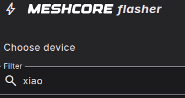
   3. Select the Seeed Studio Xiao nRF52 WIO option
      1. _Likely the middle option_
       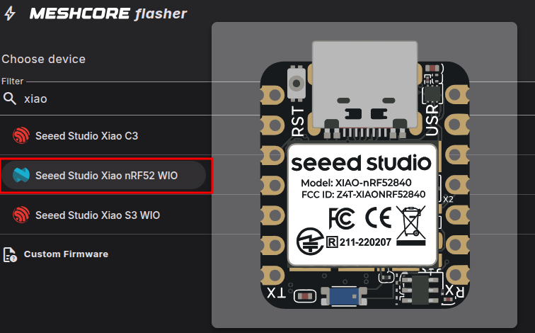
   4. Select the Repeater role
       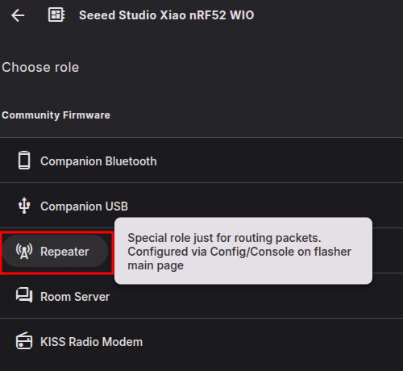
   5. Click on the `OTAFIX bootloader` link to go to github to download a bootloader we need to install.
      1. This will allow future updates to be done through Bluetooth rather than having to reconnect it to a computer.
       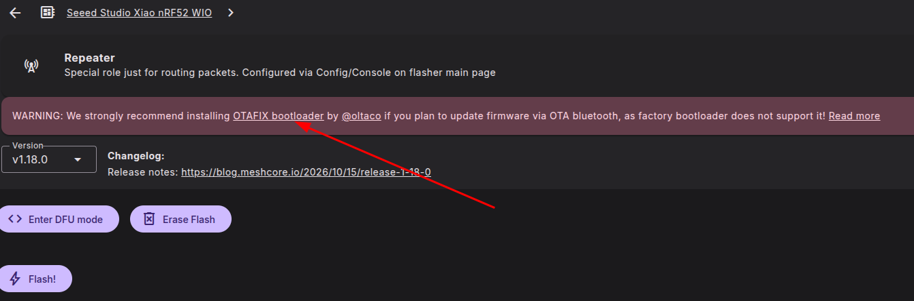
   6. Scroll Down to `Assets` and click the `"Show all 53 assets"` link.
      1. If you do not see that link, you have likely scrolled down too far.
       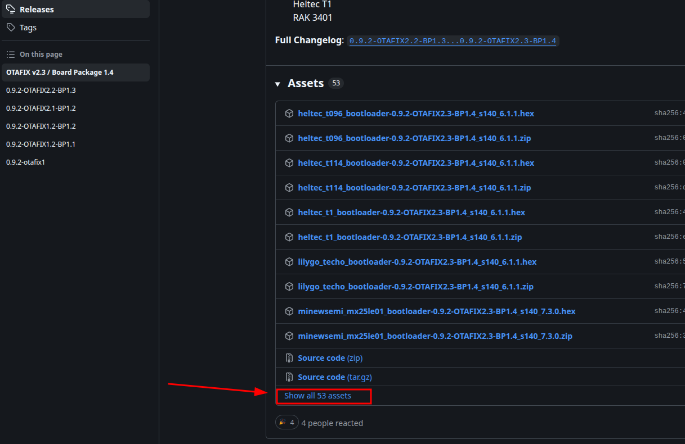
   7. Scroll down until you see a file named `update-xiao_nrf52840_ble_sense_bootloader-0.9.2-OTAFIX2.3-BP1.4_nosd.uf2`
      1. **Make sure to get the one with `sense` in the middle of the name**
      2. Show where to find the correct file (the INFO_UF2.TXT file)
       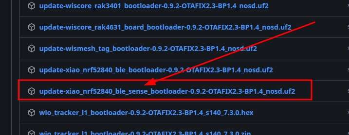
   8. Double press the `RST` button on the XIAO to put it into UF2 mode.
      1. Within 0.5 seconds
      2. A drive named XIAO-SENSE or XIAO-BOOT should appear.
       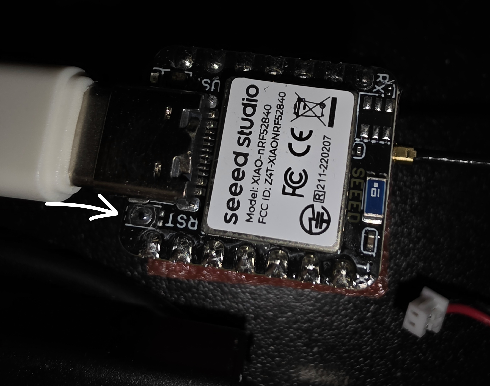
   9. Go to your Downloads and copy the downloaded bootloader uf2 file.
       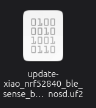
   10. Click on the drive and paste the bootloader u2f file.
       
       1. The drive will disappear and your device will reboot with the updated bootloader.
   11. Go back to the MeshCore Flasher site [https://flahsher.meshcore.io](https://flasher.meshcore.io)
   12. Click the `DFU mode active` button
       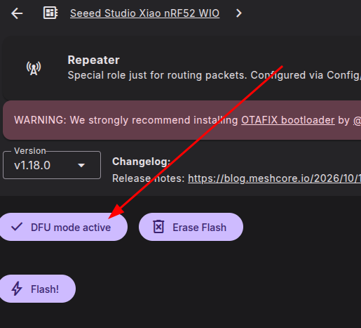
   13. Select proper USB connection and click `Connect`.
       1. It will look something like this:
       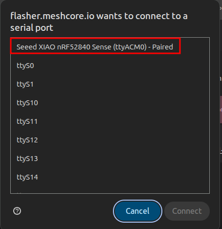
       2. If it does not work for you, you may need to refresh your browser page.
   14. Click the `Flash!` button
       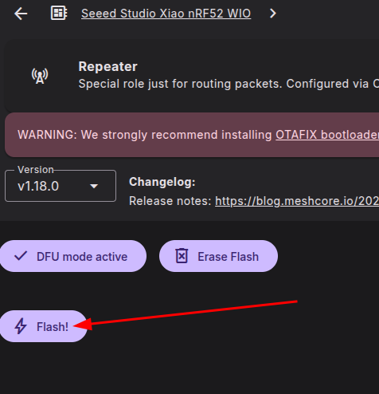
   15. Select proper USB connection and click `Connect`.
       1. It will look something like this:
       
   16. Wait for the flashing process to complete.
       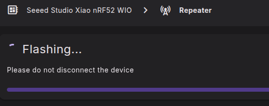
   17. Once you see this, you are ready to go onto the Configuration.
       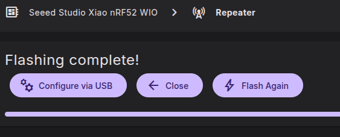

### Configuring the Repeater

1. Click the `Configure via USB` button
   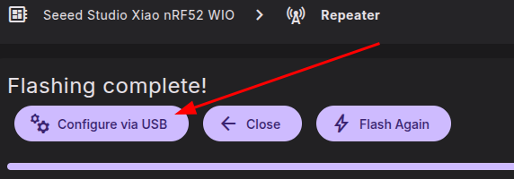
2. Click the `Connect` button
   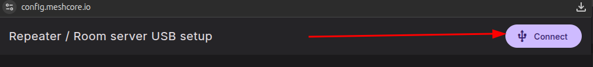
3. Select proper USB connection and click `Connect`.
   1. It will look something like this:
   
4. You should now see a window like this
   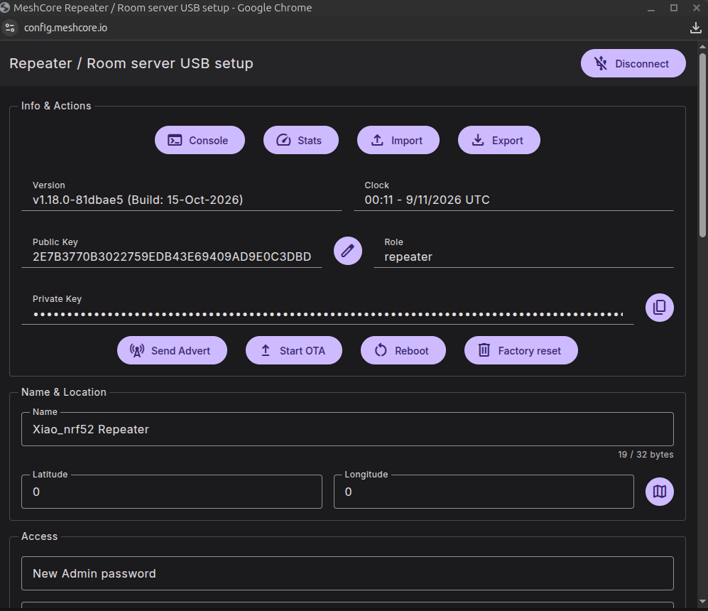
5. We are going to follow the [OKI Mesh repeater configuration guide](https://docs.okimesh.org/books/meshcore-I9o/page/repeater-configuration) for the repeater name and settings.
6. Rename your repeater:
   1. Format IN.ALL.descriptiveName
7. Enter a good Admin password
   1. Make sure to keep a note of what you make this.
8. Configure Radio Settings
   1. Preset: `USA`
      1. It will change to `Canada`, but you can change it to `USA` again, but doesn't matter as they are the same settings.
   2. Scroll down and enter `Owner info`
      1. You want to give some description of where the device is and your name on Discord, Mesh, HAM Radio call sign, etc. so one has an idea of who to contact about that repeater.
    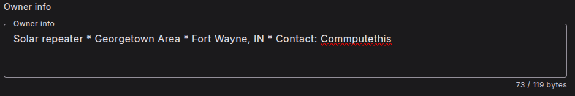
   3. Under `Advanced settings` change `Path hash mode` to either `2-byte (1)` or `3-byte (2)`
    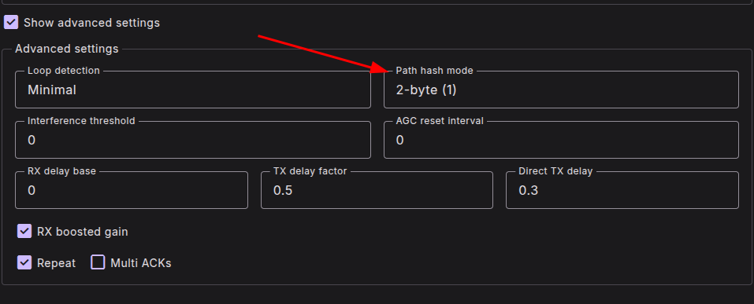
   4. Click the `Save settings` button
    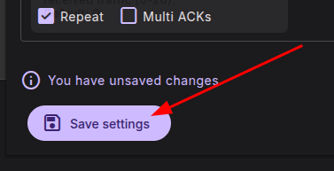
   5. Click the `OK` button to Reboot the device to apply the updated settings.
9. Disconnect the board from the computer.
10. Disconnect the supplied antenna once and set it aside.

**Configuration checkpoint:** Confirm the firmware, radio settings, repeater CLI settings, region hierarchy, standard-form name, normal startup, power-down, and removal of the supplied antenna.

## 0:45-1:50 Guided Build

Use the numbered steps in the Student Guide and Build Instructions. Demonstrate each operation before releasing the group to perform it. Stop the room at each checkpoint rather than allowing faster participants to enter a safety-critical step alone.

### Build Safety Briefing

- Verify that the solar-light switch is **OFF** before cutting the wire to the light.
- Remove the battery immediately after opening the enclosure. Use fingers or a nonconductive tool, never a metal tool.
- Keep the battery out during cutting, desoldering, soldering, and rewiring.
- Never short, puncture, crush, overheat, or reverse an 18650.
- Verify polarity with a meter. Connector shape and wire color alone are not proof.
- Never transmit without an antenna connected.
- Stop for unexpected heat, odor, smoke, uncertain polarity, or an unexpected measurement.
- Ask for help before forcing a connector or printed part.
- Do not close the enclosure until the open-unit inspection and tests pass.

There is no drilling or cutting of the enclosure in this build.

### 0:45-0:55 Steps 2 Through 5

1. Identify and retain the original mount screw and separate nut.
2. Put all removed hardware in a parts tray.
3. Confirm that the solar-light switch is **OFF**.
4. Cut the wire joining the enclosure to the light. The entire wire will be removed.
5. Remove and retain the enclosure screws, then open the cover.
6. Remove the 18650 using fingers or a nonconductive tool.
7. Pull the cut wire through its feed-through.
8. Remove and retain the two screws holding the switch PCB.
9. Clip the cut light wire at both PCB connections, both solar-panel leads at the PCB, and the negative battery lead at the PCB.

The original PCB is retained only so its switch can be placed inline with CN3065 `SYS OUT`.

**Checkpoint 1:** The battery is out, the original hardware is retained, and the switch PCB and required wires are accessible.

### 0:55-1:05 Steps 6 and 7

1. Identify the two marked copper paths while the battery and panel are disconnected.
2. Demonstrate how the paths are opened and checked.
3. Remove the factory foam gasket.
4. Clean the channel and seat the TPU gasket evenly.

**The instructor will provide additional instruction for completing and checking the PCB modification.**

**Checkpoint 2:** The PCB modification has been checked and the TPU gasket is seated evenly.

### 1:05-1:25 Steps 8 Through 11

#### Rewire the Battery Holder

Desolder the original negative wire, install the negative JST conductor, then desolder the original positive wire and install the positive JST conductor. The old negative wire is not reused.

#### Add the Solar-Panel JST Lead

The panel terminals are not labeled. Change only **one conductor at a time**: remove one original wire and immediately solder its matching JST conductor before touching the other terminal.

#### Wire the XIAO and Retained Switch PCB

- Original battery-holder positive wire to XIAO `BAT+`
- JST negative conductor to XIAO `BAT-`
- Positive conductor from that JST lead to the retained PCB, placing the switch inline with CN3065 `SYS OUT`

#### Connect the CN3065

**JST polarity:** The class cables have already been corrected by swapping the red and black positions where needed. Students must still verify actual positive and negative polarity before connecting them.

Connect the verified JST plugs for solar input, battery, and system output. Do not install the battery.

**Checkpoint 3:** A presenter or helper verifies polarity, solder joints, XIAO battery connections, the switch path, and all three CN3065 connections.

### 1:25-1:42 Steps 12 Through 15

1. Feed the pigtail through the PETG mount.
2. Push the N connector upward through the antenna opening from the bottom.
3. Align the connector's flat sides.
4. Install the tooth lock washer, flat washer, and nut in that order.
5. Tighten without crushing the PETG mount.
6. Feed the U.FL end through the enclosure opening.
7. Attach the mount with the retained screw and nut.
8. Attach and hand-tighten the ALFA antenna.
9. Seat the rubber switch boot.
10. Reinstall the switch PCB with its two original screws.
11. Cover the PCB with painter's tape.
12. Press the U.FL plug straight down onto the Wio socket without twisting or pulling the coax.
13. Support the boards and pigtail while installing the antenna connector clamp.

The ALFA antenna is attached before the radio is powered. Keep the coax bend gentle.

**Checkpoint 4:** The antenna is attached, the switch boot and PCB are reinstalled, the U.FL connection is seated, and the clamp supports the assembly without flexing the boards.

### 1:42-1:50 Steps 16 Through 18

#### Clean the Panel Before Testing

Remove the solar-panel sticker. Use Goo Gone to remove the residue, then clean the panel with isopropyl alcohol (aka IPA).

#### Inspect and Test the Open Unit

Before installing the battery, inspect polarity, solder joints, PCB modifications, JST positions, switch insulation, rubber-boot seating, U.FL seating, clamp support, antenna connection, and wire routing.

Install the 18650 with correct polarity and test:

- Normal startup
- Saved regional setting, class settings, and repeater name
- LoRa relay through the ALFA antenna
- Solar charging response

Disconnect the battery immediately for heat, odor, smoke, or abnormal behavior.

#### Close and Weatherproof

After the tests pass:

1. Arrange components and wires clear of the screw posts.
2. Close the enclosure without forcing it.
3. Reinstall the original enclosure screws gradually.
4. Confirm that the ALFA antenna joint is clean, dry, and hand-tight.
5. Stretch and overlap self-fusing silicone tape across the complete antenna joint without covering the radiating body.

**Checkpoint 5:** The unit is closed, the original hardware is installed, the antenna joint is weatherproofed, and the finished repeater has no light.

If a unit is not ready to close at 1:50, bag and label its parts and record the specific next step. Do not bypass an inspection or safety check to finish on time.

## 1:50-2:00 Installation Maintenance and Wrap Up

### Explain Pole Mounting

- Use zip ties or hose clamps to attach the PETG mount to a pole.
- These fasteners are for pole mounting, not internal cable management or strain relief.
- Keep the ALFA antenna vertical.
- Set the panel for seasonal sun.
- Confirm permission, stability, safe access, and a water-shedding orientation.

### Review Maintenance

Inspect after severe weather and periodically. Clean the panel; inspect the pole fasteners, PETG mount, enclosure, TPU gasket, silicone tape, and antenna connection; look for corrosion or moisture; review battery performance before winter; and retest after moving the unit or changing its antenna system.

### Closing Message

"The repeater's value depends on where it is installed and whether it remains powered, dry, and serviceable. Test the proposed location, obtain permission, document the repeater name and location, and inspect it periodically."

## Troubleshooting Strategy

- Move problem units to the troubleshooting area.
- Compare them with the completed reference unit.
- Test one variable at a time.
- Keep a known-good battery, USB cable, CN3065, and radio available.
- Pair participants who finish early with those who want assistance.
- Label unfinished units and record a clear next step.

| Symptom | Check first |
| --- | --- |
| No power | Battery polarity and voltage, JST polarity, switch wiring, solder joints, and CN3065 path |
| No charging | Solar illumination, panel polarity, CN3065 connections, and PCB trace modifications |
| Poor LoRa range | Regional preset, ALFA antenna, U.FL seating, height, and obstructions |
| Intermittent operation | Loose connection, weak battery, pinched wire, solder joint, water, or shade |

Never bypass a polarity concern, battery concern, damaged enclosure, or questionable electrical connection simply to finish on time.

## Presenter Time Checks

- At **0:15**, begin placement and solar guidance.
- At **0:30**, begin firmware and repeater configuration.
- At **0:45**, confirm that switches are off and begin the build.
- At **1:05**, the PCB modification and TPU gasket should be complete.
- At **1:25**, electrical rewiring should be ready for inspection.
- At **1:42**, begin panel cleaning, final inspection, and open-unit testing.
- At **1:50**, stop construction and begin installation and maintenance guidance.
- At **2:00**, end with a documented follow-up step for any unfinished unit.

---
