<!-- Use guide-print.css when exporting this Markdown to PDF. -->

<div class="cover">

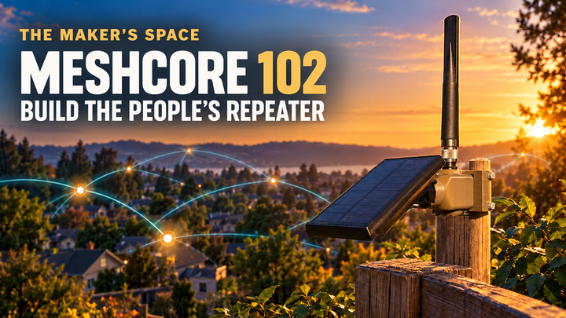

# MeshCore 102

## Build The People's Repeater

### Student Guide and Build Instructions

**The Maker's Space · November 2026**

Build a solar-powered MeshCore repeater from a Harbor Breeze solar-light enclosure, a Seeed Studio XIAO nRF52840, and a Wio-SX1262 LoRa radio.

</div>

<div class="page-break" style="page-break-after: always; break-after: page;"></div>

## Project Repository and Build Sources

- [Class repository](https://github.com/commputethis/TheMaker-sSpace_MeshCore102) — <https://github.com/commputethis/TheMaker-sSpace_MeshCore102>
- [Build reference video 1](https://www.youtube.com/watch?v=yAmINEghCOc) — <https://www.youtube.com/watch?v=yAmINEghCOc>
- [Build reference video 2](https://www.youtube.com/watch?v=eXMlvGiI7Hs) — <https://www.youtube.com/watch?v=eXMlvGiI7Hs>

This class build combines ideas from both reference videos with the specific parts, printed components, wiring, and procedures documented in this guide.

## What You Will Build

The People's Repeater is a compact, solar-powered MeshCore relay for the 915 MHz band. The original light is removed; the finished repeater has an outdoor antenna and **does not have a light**.

<figure class="keep-together">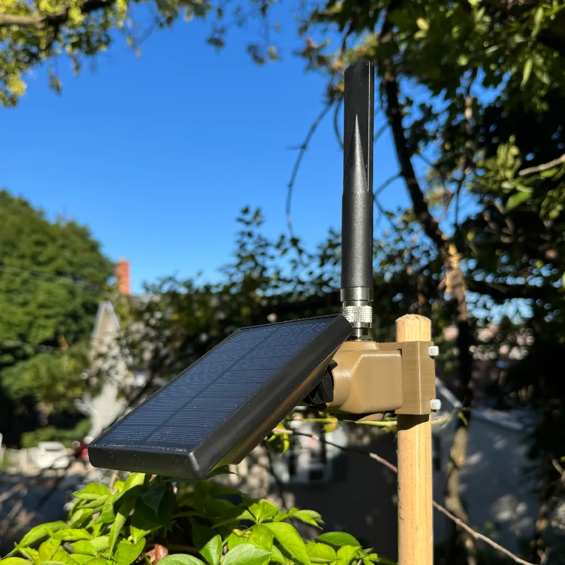<figcaption>Example finished repeater. The exact PETG mount used in class may differ.</figcaption></figure>

## MeshCore Roles and Room Servers

- A **companion** gives a person access to the mesh.
- A **repeater** extends useful coverage by forwarding packets toward their destinations.
- A **Room Server** is a shared message board. It stores posts and can deliver unseen history when a user returns, unlike an ordinary channel where a message can be missed while the user is out of range.

A Room Server and repeater solve different problems. MeshCore recommends separate devices for the best experience; enabling repeat behavior on a Room Server does not provide the full repeater feature set. This class builds a dedicated repeater. See the [MeshCore FAQ](https://github.com/meshcore-dev/MeshCore/blob/main/docs/faq.md): <https://github.com/meshcore-dev/MeshCore/blob/main/docs/faq.md>

<div class="page-break" style="page-break-after: always; break-after: page;"></div>

## Parts

<figure class="keep-together">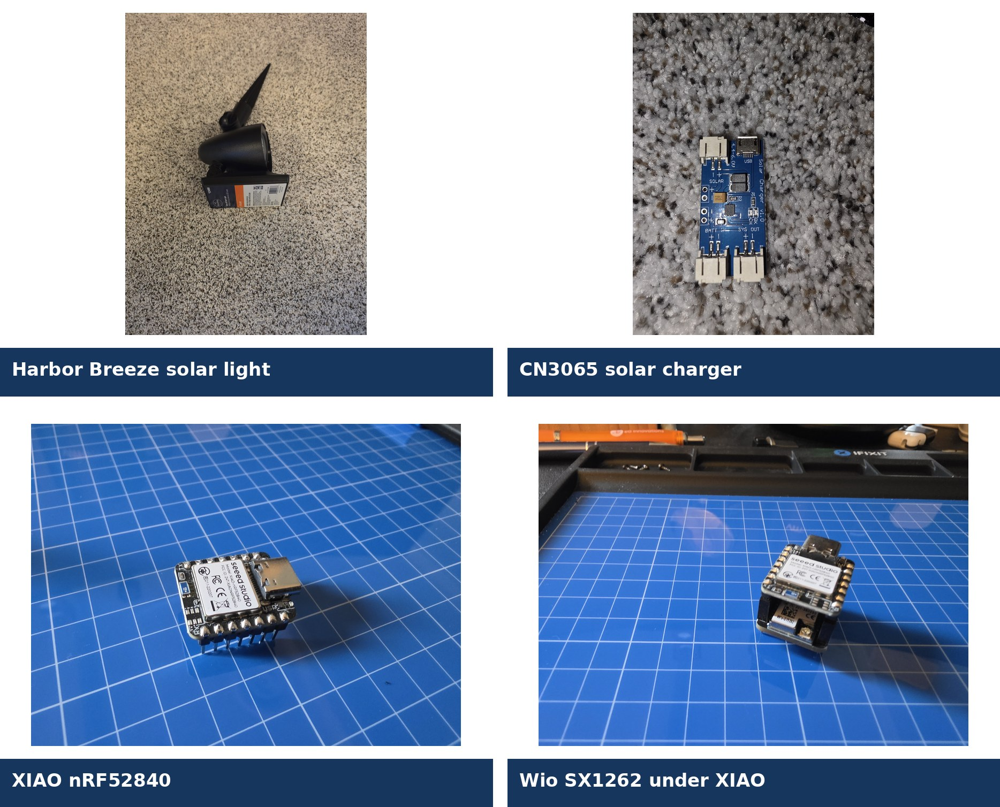<figcaption>Core electronics and power components. The Wio is the lower board beneath the XIAO.</figcaption></figure>

### Electronics and power

- Harbor Breeze solar light with included **1500 mAh 18650 battery**
- Seeed Studio **XIAO nRF52840** and **Wio-SX1262** LoRa radio
- **ACEIRMC CN3065** mini solar LiPo charger
- Three 100 mm female-socket **JST PH 2.0** silicone-wire cables

### Antenna system

- **ALFA Network AOA-915-5ACM**, 5 dBi outdoor 915 MHz antenna
- 6 in / 15 cm **U.FL1-to-N-female** RG178 pigtail
- Waterproof self-fusing silicone tape

> The small antenna supplied attached to the Wio stays connected to protect the radio connector while the prepared board is handled. Remove it once during Step 14, immediately before connecting the external pigtail. It is not used in the finished repeater.

<figure class="keep-together">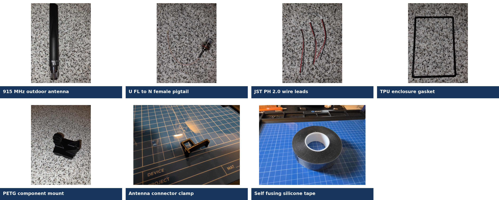<figcaption>Antenna and enclosure hardware, including the PETG component mount and connector clamp.</figcaption></figure>

### Enclosure and mounting

- 3D-printed **TPU gasket** and **PETG component mount**
- 3D-printed PETG [**antenna connector clamp**](https://www.printables.com/model/1761740-xiao-nrf52840-wio-sx1262-antenna-clamp) — <https://www.printables.com/model/1761740-xiao-nrf52840-wio-sx1262-antenna-clamp>
- Zip ties **or** hose clamps for attaching the mount to a pole
- Original enclosure screws and original mount screw and nut

The [Harbor Breeze solar mesh-node models](https://www.printables.com/model/1748950-26-harbor-breeze-solar-mesh-node-mounts-meshtastic) page contains the component mount shown here, alternate mounts, and the TPU gasket: <https://www.printables.com/model/1748950-26-harbor-breeze-solar-mesh-node-mounts-meshtastic>

> Put all removed screws and the separate mount nut in a parts tray. They are reused; they are not extra hardware.

### Battery note

The class uses the included 1500 mAh 18650. A larger-capacity compatible 18650 may provide more winter reserve, but verify chemistry, voltage, size, polarity, terminals, protection, and charger compatibility.

## Safety Rules

- Remove the battery immediately after opening the enclosure. Use fingers or a nonconductive tool—never a metal tool.
- Keep the battery out during cutting, desoldering, soldering, and rewiring.
- Never short, puncture, crush, overheat, or reverse an 18650.
- Visually verify every connection against the hardware labels and illustrated build instructions.
- Never transmit without an antenna connected.
- Stop for unexpected heat, odor, smoke, uncertain wiring, or abnormal behavior.

## Placement Before the Build

- Favor useful height, open surroundings, and a clear path toward the area served.
- Keep the vertical antenna clear of nearby metal where practical.
- Give the solar panel several hours of direct sun, including during winter.
- In Indiana, a generally southerly exposure at approximately a 40° angle is a useful starting point, adjusted for shade.
- Choose a safe, permitted, stable, serviceable location and orient seams to shed water.

Planning tools:

- [MeshMapper](https://fwa.meshmapper.net/) for purpose and radio-path planning — <https://fwa.meshmapper.net/>
- [Solar tilt-angle calculator](https://www.baess.app/tools/solar-tilt-angle-calculator) for panel-angle planning — <https://www.baess.app/tools/solar-tilt-angle-calculator>

<div class="page-break" style="page-break-after: always; break-after: page;"></div>

# Build Guide

## 1. Confirm the Prepared Board and Review Firmware Setup

> **Class boards are flashed, configured, tested, and labeled before class. Do not reflash or reconfigure your class board during the build. The instructor will demonstrate Sections 1A through 1E. These instructions remain here for future reference.**

Match the removable label on your board or kit to the temporary repeater name supplied by the instructor, such as `IN.ALL.FWA.Class01`. Leave the small antenna attached while handling the prepared board. It will be removed once during Step 14 and replaced immediately with the external pigtail.

### 1A. Select the Board and Repeater Firmware (Reference)

1. Connect the XIAO and Wio assembly to the computer with a USB cable.
2. Open the MeshCore Flasher [https://flasher.meshcore.io/](https://flasher.meshcore.io/).
3. Type `xiao` in the search box.

<figure class="keep-together">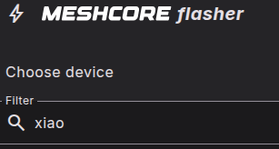<figcaption>Filter the device list by entering xiao.</figcaption></figure>

4. Select **Seeed Studio Xiao nRF52 WIO**. It will likely be the middle option.

<figure class="keep-together">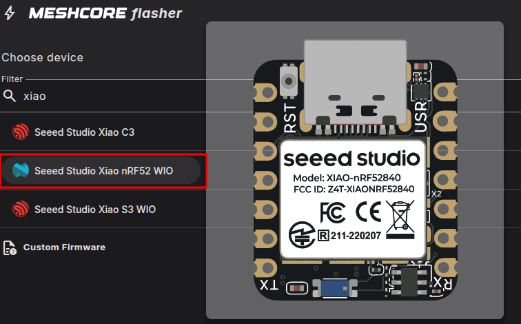<figcaption>Select the Seeed Studio Xiao nRF52 WIO target.</figcaption></figure>

5. Select the **Repeater** role.

<figure class="keep-together">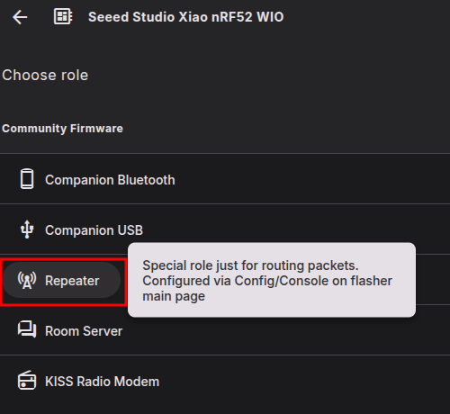<figcaption>Select Repeater as the firmware role.</figcaption></figure>

### 1B. Update the OTAFIX Bootloader (Reference)

The OTAFIX bootloader permits future firmware updates over Bluetooth without reopening the finished enclosure and reconnecting the board to a computer. Install it before flashing the repeater firmware.

1. Open the [OTAFIX bootloader releases page](https://github.com/oltaco/Adafruit_nRF52_Bootloader_OTAFIX/releases) directly: <https://github.com/oltaco/Adafruit_nRF52_Bootloader_OTAFIX/releases>

   Do not select the OTAFIX link on the MeshCore Flasher page for this procedure. That link downloads a ZIP file rather than the UF2 file needed below. The flasher's **Read more** link reaches instructions that point to the same GitHub releases page, but the direct link is faster.

2. Open the appropriate release, scroll to **Assets**, and select **Show all assets**. The displayed number of assets may change between releases.

<figure class="keep-together">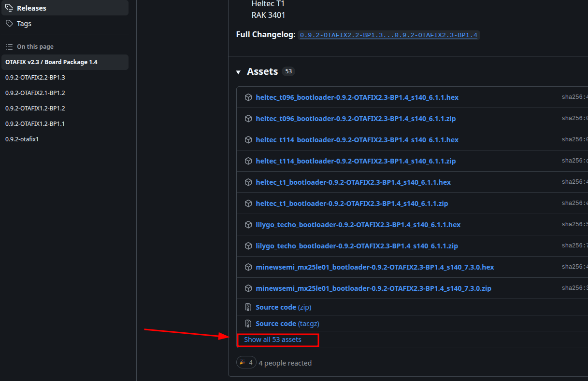<figcaption>Expand the complete release-asset list.</figcaption></figure>

3. Download this UF2 file:

   `update-xiao_nrf52840_ble_sense_bootloader-0.9.2-OTAFIX2.3-BP1.4_nosd.uf2`

   **Use the file with `sense` in the middle of its name.**

<figure class="keep-together">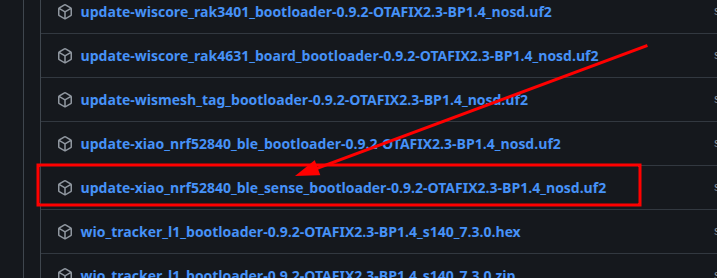<figcaption>Select the XIAO nRF52840 Sense OTAFIX UF2 file.</figcaption></figure>

4. Double-press the XIAO `RST` button within approximately 0.5 seconds to enter UF2 mode. A drive named `XIAO-SENSE` or `XIAO-BOOT` should appear.

<figure class="keep-together">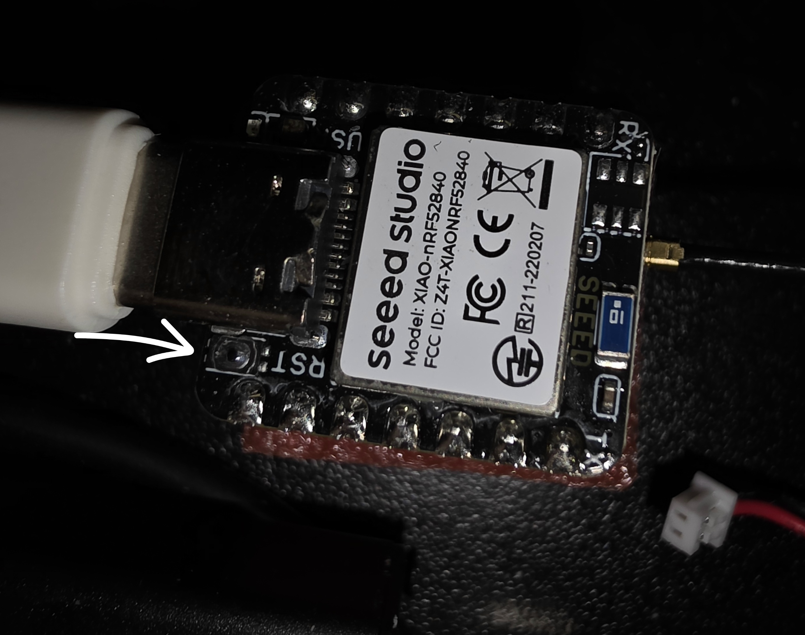<figcaption>Double-press the reset button to enter UF2 mode.</figcaption></figure>

5. Locate the downloaded UF2 bootloader file in the computer's Downloads folder.

<figure class="keep-together">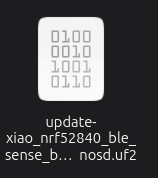<figcaption>Copy the downloaded bootloader UF2 file.</figcaption></figure>

6. Open the `XIAO-SENSE` or `XIAO-BOOT` drive and paste the UF2 file into it.

<figure class="keep-together"><figcaption>Paste the bootloader UF2 file onto the XIAO drive.</figcaption></figure>

The drive will disappear when the copy completes, and the XIAO will reboot with the updated bootloader.

### 1C. Flash the Repeater Firmware (Reference)

1. Return to the [MeshCore Flasher](https://flasher.meshcore.io/) with the XIAO WIO target and Repeater role selected: <https://flasher.meshcore.io/>
2. Select **DFU mode active**.

<figure class="keep-together">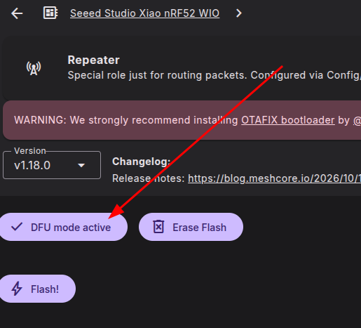<figcaption>Tell the flasher that the board is in DFU mode.</figcaption></figure>

3. Select the correct USB device and choose **Connect**. If the device is not listed or the connection fails, refresh the browser and try again.

<figure class="keep-together">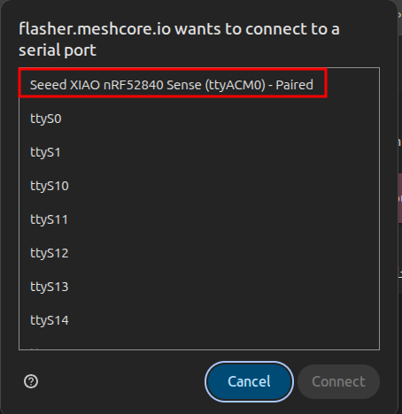<figcaption>Select the USB connection for the XIAO board.</figcaption></figure>

4. Select **Flash!**

<figure class="keep-together">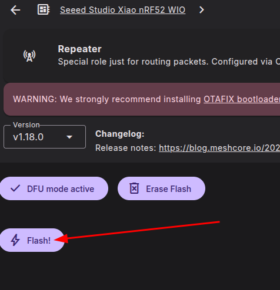<figcaption>Begin flashing the repeater firmware.</figcaption></figure>

5. If the browser asks again, select the same USB device and choose **Connect**.
6. Wait for the flashing operation to complete. Do not disconnect the USB cable while the firmware is being written.

<figure class="keep-together">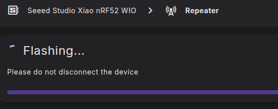<figcaption>Wait while the repeater firmware is written.</figcaption></figure>

<figure class="keep-together">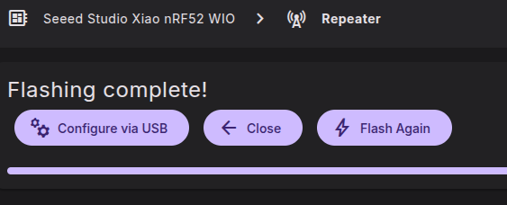<figcaption>Continue only after the flasher reports completion.</figcaption></figure>

### 1D. Configure the Repeater (Reference)

1. Select **Configure via USB**.

<figure class="keep-together">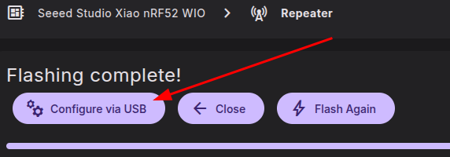<figcaption>Open the USB configuration tool.</figcaption></figure>

2. Select **Connect**.

<figure class="keep-together">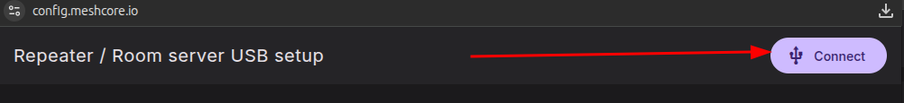<figcaption>Start the USB connection.</figcaption></figure>

3. Select the correct USB device and choose **Connect**.

<figure class="keep-together"><figcaption>Select the XIAO USB device.</figcaption></figure>

4. Confirm that the repeater setup screen opens.

<figure class="keep-together">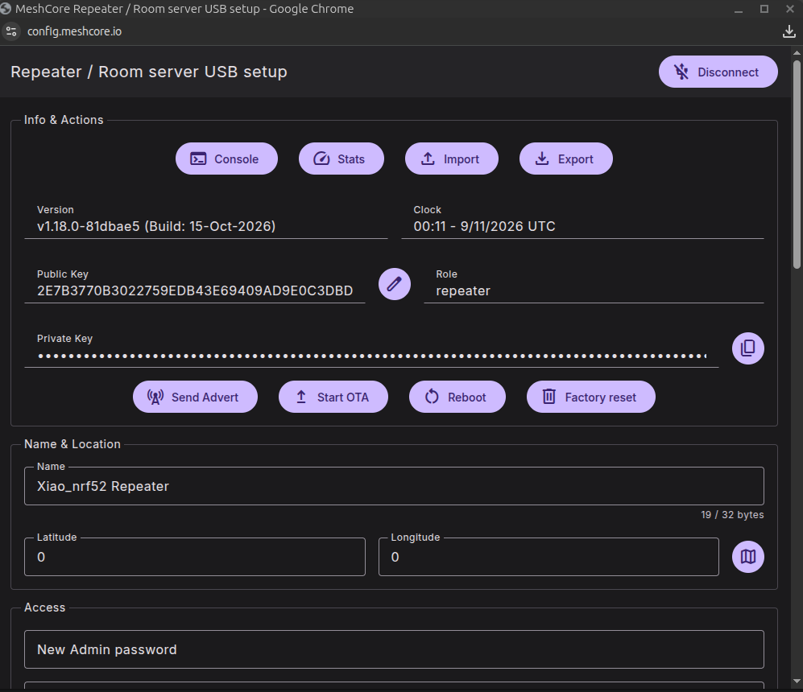<figcaption>Use the setup screen to enter the repeater settings.</figcaption></figure>

5. Follow the [OKI Mesh repeater configuration guide](https://docs.okimesh.org/books/meshcore-I9o/page/repeater-configuration): <https://docs.okimesh.org/books/meshcore-I9o/page/repeater-configuration>
6. Enter the repeater name using the standard format `StateCode.CountyCode.descriptiveName`.

   - Allen County: `IN.ALL.descriptiveName`
   - Local Fort Wayne convention: `IN.ALL.FWA.descriptiveName`
   - [Repeater naming reference](https://docs.okimesh.org/books/meshcore-I9o/page/repeater-naming) — <https://docs.okimesh.org/books/meshcore-I9o/page/repeater-naming>
   - [County abbreviations](https://docs.okimesh.org/books/meshcore-I9o/page/county-abbreviations) — <https://docs.okimesh.org/books/meshcore-I9o/page/county-abbreviations>

7. Create a strong administrator password and record it in a secure place.
8. Set the radio preset to `USA`. Confirm that the resulting values match the NEIMesh settings in the next section. If the interface changes the displayed preset to `Canada`, set it back to `USA` and verify the individual values.
9. Enter useful **Owner info**, such as the general installation location and a Discord name, mesh identifier, or amateur-radio call sign that people can use to contact you. Include only information you are comfortable sharing.

<figure class="keep-together">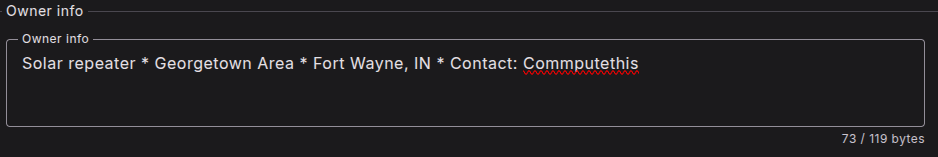<figcaption>Add enough owner information to identify and service the repeater.</figcaption></figure>

10. Under **Advanced settings**, set **Path hash mode** to `2-byte (1)`.

<figure class="keep-together">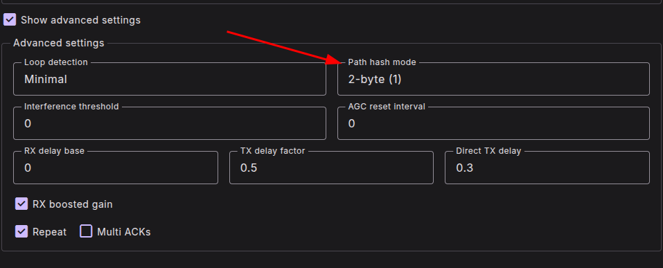<figcaption>Select the 2-byte path-hash mode.</figcaption></figure>

11. Select **Save settings**, then choose **OK** to reboot the device and apply the changes.

<figure class="keep-together">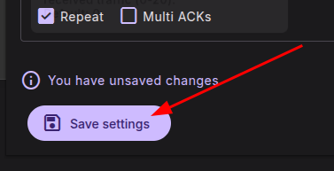<figcaption>Save the configuration and allow the device to reboot.</figcaption></figure>

### 1E. Apply the NEIMesh Settings (Reference)

MeshCore devices must use matching radio settings to communicate. NEIMesh currently recommends the following local baseline. These recommendations may change as the mesh grows.

#### Radio settings

- Preset: `USA`
- Frequency: `910.525 MHz`
- Bandwidth: `62.5 kHz`
- Spreading factor: `7`
- Coding rate: `5`
- Path hash size: **2-byte**

#### Repeater command-line settings

Open the repeater command-line interface and enter:

```text
set agc.reset.interval 500
set multi.acks 1
set loop.detect minimal
```

#### Repeater region settings

Regions are not currently enforced, but the local hierarchy prepares the repeater for future growth. A weather-alert node already scopes messages to the `fwa` region; repeaters that do not define that region will not receive those scoped messages.

```text
region put us-in
region put nei us-in
region put fwa nei
region allowf *
```

The hierarchy is `us-in` for Indiana, `nei` for northeast Indiana, and `fwa` for the Fort Wayne area.

### 1F. Confirm Your Prepared Board

1. Confirm that the removable board or kit label shows the temporary repeater name assigned during instructor preparation.
2. Record the supplied name and preparation information in the Build Record at the end of this guide.
3. Leave the supplied small Wio antenna attached until Step 14.

## 2. Retain the Mount Hardware

<figure class="keep-together">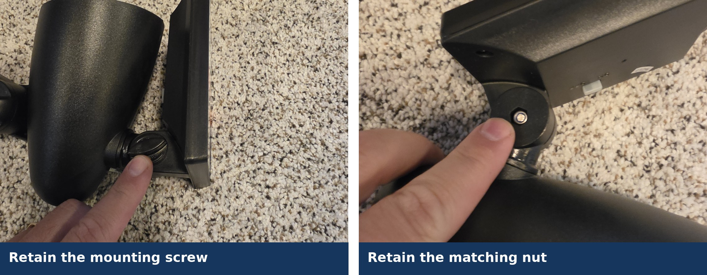<figcaption>Retain the mounting screw and separate matching nut. Both are reused.</figcaption></figure>

## 3. Switch Off and Cut Away the Light

Verify the solar-light switch is **OFF**, then cut the wire joining the enclosure to the light. The exact cut location is not important because the entire wire will eventually be removed.

<figure class="keep-together">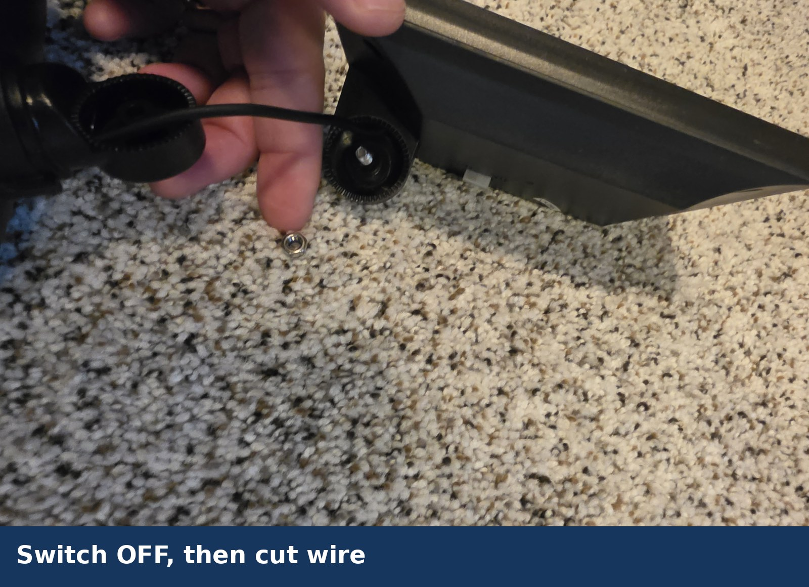<figcaption>Switch the light off before cutting the wire.</figcaption></figure>

## 4. Open the Enclosure and Remove the Battery

Remove and retain the enclosure screws. Open the cover carefully, then remove the 18650 with fingers or a nonconductive tool—never a metal tool. Keep it out until the wiring inspection is complete and the open-unit test is ready. After removing the battery, pull the cut wire through its feed-through and remove and retain the two screws holding the switch/PCB.

<figure class="keep-together">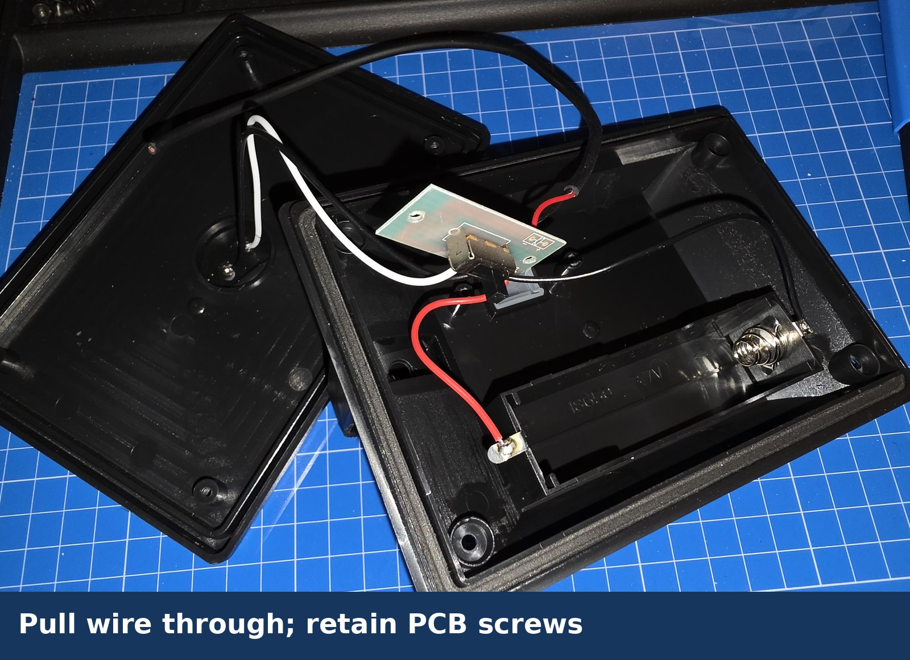<figcaption>Pull the wire through only after opening the enclosure and removing the battery.</figcaption></figure>

## 5. Remove the Unused Original Wiring

Clip the cut light wire at both PCB connections, both solar-panel leads at the PCB, and the negative battery lead at the PCB. Retain the PCB and switch; they will be used only as a switch inline with CN3065 SYS OUT.

<figure class="keep-together">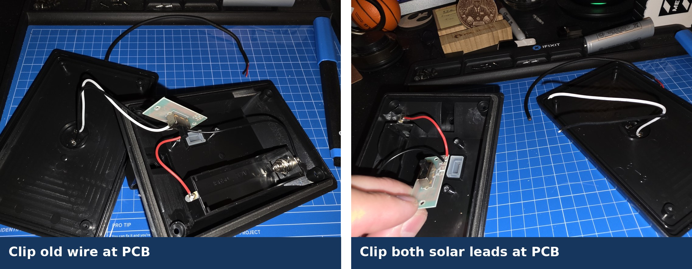<figcaption>Clip the old light and solar-panel wires at the PCB.</figcaption></figure>
<figure class="keep-together">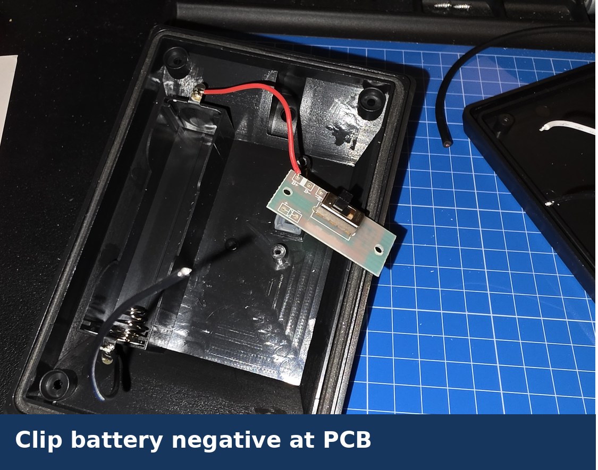<figcaption>Disconnect battery negative.</figcaption></figure>

## 6. Open the Two Marked PCB Traces

With the battery and panel disconnected, identify the two marked copper paths.

**The instructor will provide additional instructions for completing and checking this modification.**

<figure class="keep-together full-width">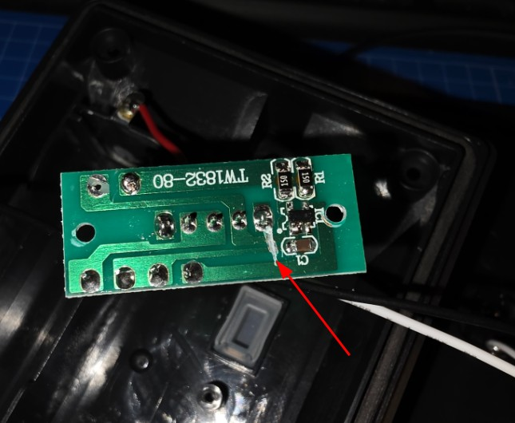<figcaption>The instructor will demonstrate the two marked PCB modifications.</figcaption></figure>

## 7. Install the TPU Gasket

Remove the foam gasket, clean the channel, and seat the TPU gasket evenly.

<figure class="keep-together">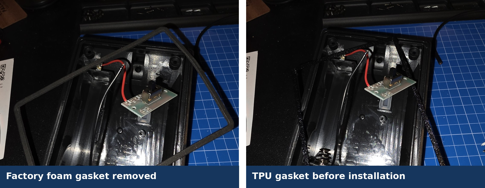<figcaption>Factory gasket removed; TPU replacement ready.</figcaption></figure>
<figure class="keep-together">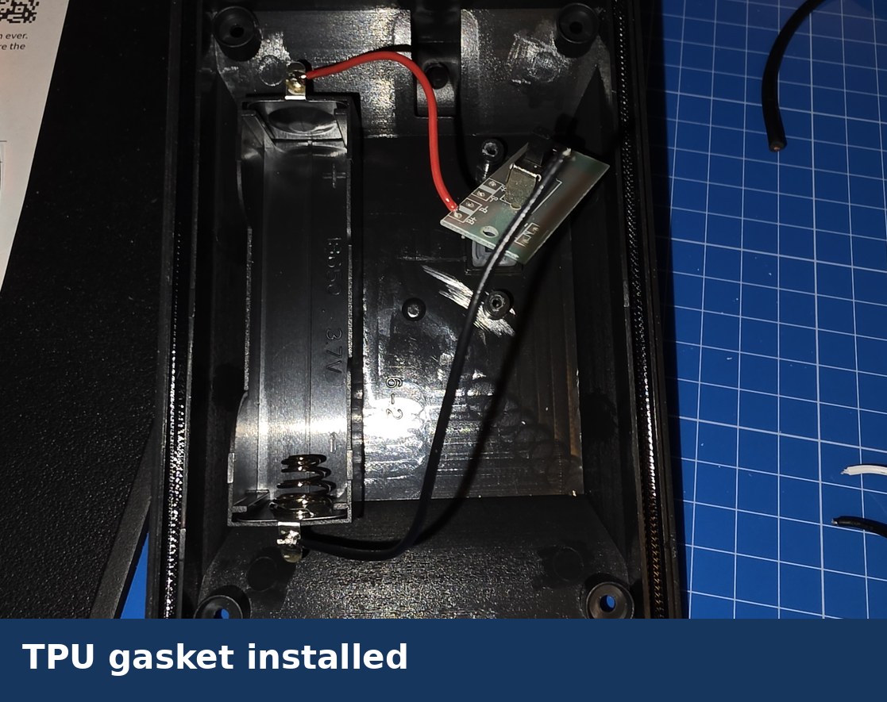<figcaption>TPU gasket installed.</figcaption></figure>

## 8. Rewire the Battery Holder

Desolder the original negative wire; it is not reused. Install the negative JST conductor. Then desolder the original positive wire and install the positive JST conductor.

<figure class="keep-together">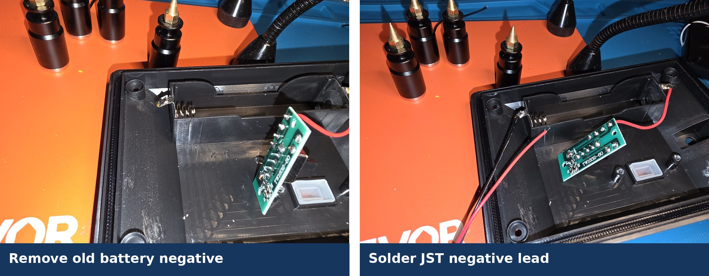<figcaption>Remove the old negative wire and install the JST negative.</figcaption></figure>
<figure class="keep-together">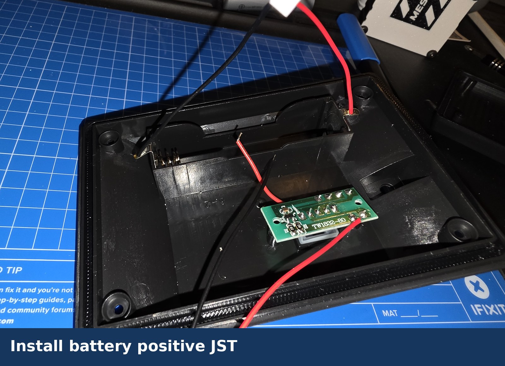<figcaption>Complete the positive battery-holder connection.</figcaption></figure>

## 9. Add the Solar-Panel JST Lead

The panel terminals are unlabeled. Change only **one conductor at a time**: remove one original wire and immediately install its matching JST conductor before touching the other terminal.

<figure class="keep-together">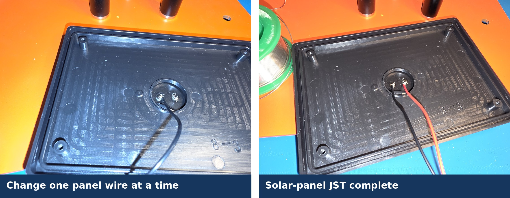<figcaption>Change the panel wires one at a time, then inspect the completed JST lead.</figcaption></figure>

## 10. Wire the XIAO and Retained Switch

- Original battery-holder positive wire to XIAO `BAT+`
- JST negative conductor to XIAO `BAT−`
- That JST lead's positive conductor to the retained PCB, placing the switch inline with CN3065 `SYS OUT`

<figure class="keep-together">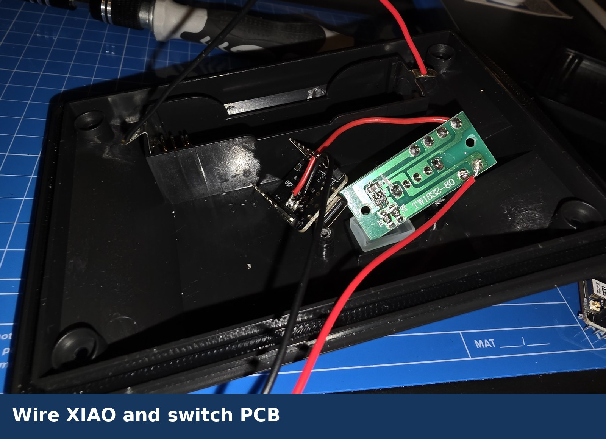<figcaption>Wire the XIAO battery terminals and retained switch PCB.</figcaption></figure>

## 11. Connect the CN3065

> **JST wiring:** The class cables have already been corrected by swapping the red and black positions where needed. Visually verify that each conductor goes to the labeled connection shown in this guide.

Connect the three verified JST plugs for solar input, battery, and system output. Do not install the battery yet.

<figure class="keep-together">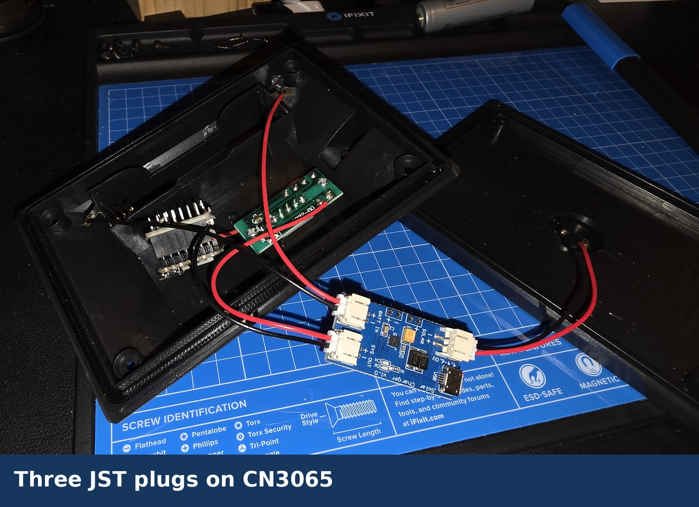<figcaption>Connect all three verified JST plugs to the appropriate CN3065 positions.</figcaption></figure>

## 12. Install the N Connector in the PETG Mount

Feed the pigtail through the mount, then push the connector upward from the bottom. Align its flat sides before applying gentle force. Install the tooth lock washer, then flat washer, then nut.

<figure class="keep-together">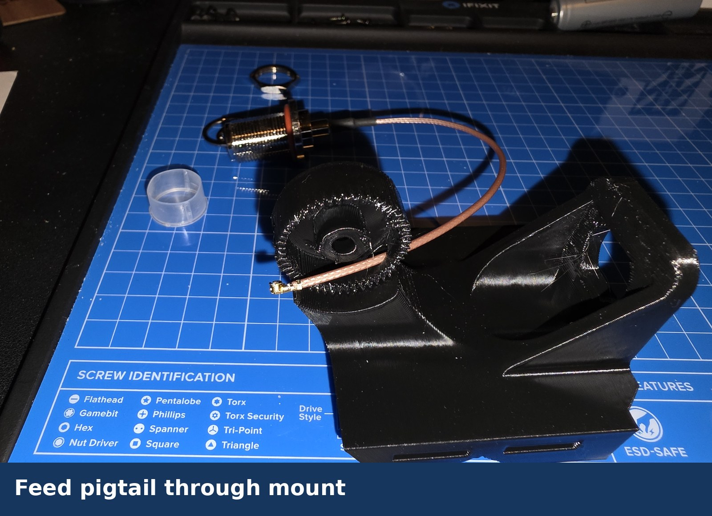<figcaption>Feed the pigtail through the PETG mount before seating the N connector.</figcaption></figure>
<figure class="keep-together">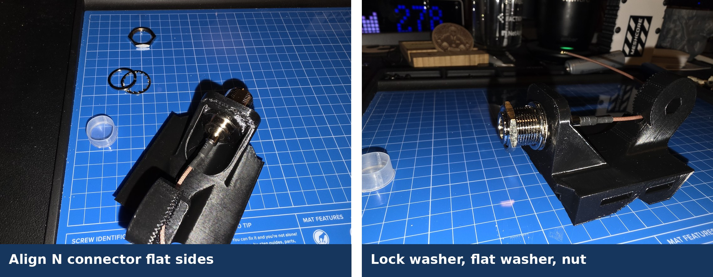<figcaption>Align the flats and use the illustrated washer order.</figcaption></figure>
<figure class="keep-together">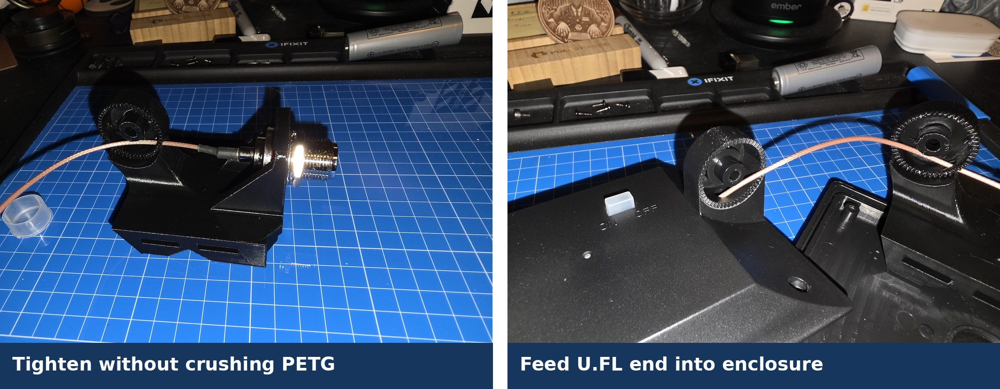<figcaption>Tighten without crushing PETG, then feed the U.FL end inside.</figcaption></figure>

## 13. Attach the Mount, Antenna, and Route the Pigtail

Attach the mount with the retained screw and nut. Keep the coax bend gentle. Attach and hand-tighten the ALFA antenna on the exterior N connector.

<figure class="keep-together">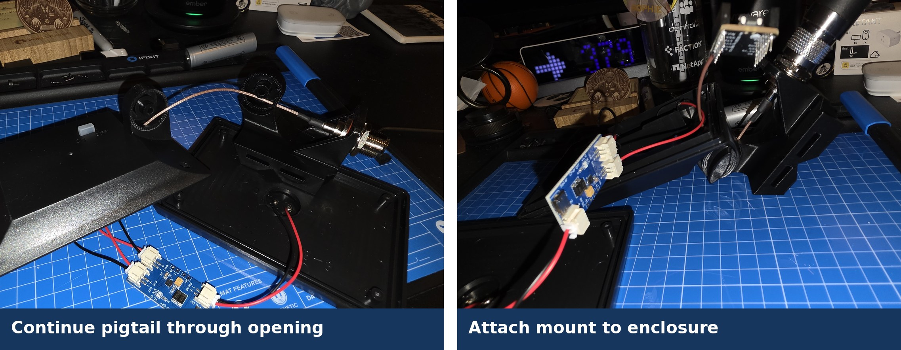<figcaption>Pigtail routed and mount attached.</figcaption></figure>

## 14. Reinstall the Switch and Connect the Radio

Before reinstalling the switch/PCB, make sure the rubber switch boot is seated correctly to keep moisture out. Reinstall the switch/PCB with its two original screws, then cover it with painter's tape. Remove the small supplied antenna from the Wio and set it aside. Immediately press the pigtail's U.FL plug straight down onto the Wio socket; do not twist or pull on the coax.

<figure class="keep-together">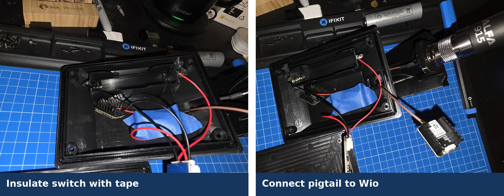<figcaption>Seat the rubber boot, reinstall the screws, apply tape, and connect the pigtail.</figcaption></figure>

## 15. Install the Antenna Connector Clamp

Support the boards and pigtail while installing the clamp. Do not flex the boards or lever against U.FL.

<figure class="keep-together">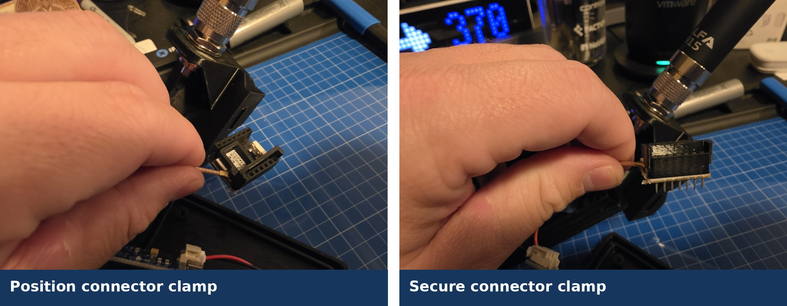<figcaption>Position and secure the connector clamp.</figcaption></figure>

## 16. Clean the Panel, Inspect, Install the Battery, and Test

Remove the solar-panel sticker. Use Goo Gone to remove adhesive residue, then clean the panel with isopropyl alcohol. Arrange components and visually verify the labeled battery orientation, solder joints, trace cuts, JST positions, switch insulation, and pigtail seating. Install the 18650 in the labeled orientation and test startup, the saved settings and name, LoRa relay through the ALFA antenna, and charging response. Disconnect immediately for heat, odor, smoke, or abnormal behavior.

<figure class="keep-together">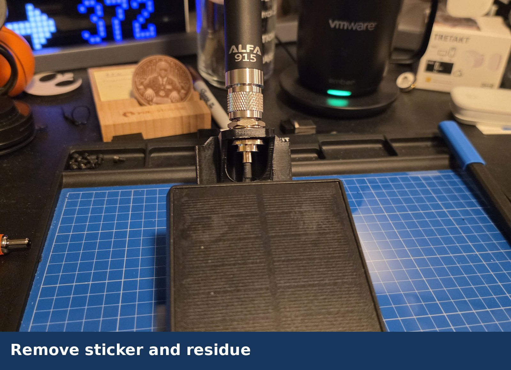<figcaption>Remove the sticker and clean the panel before testing.</figcaption></figure>

## 17. Close and Finish

After tests pass, arrange wires clear of screw posts, close the enclosure, and reinstall original screws gradually.

<figure class="keep-together">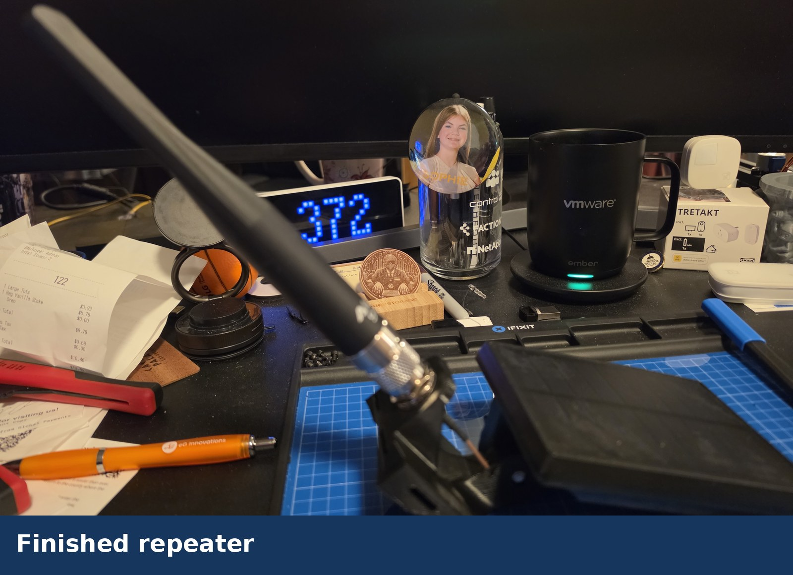<figcaption>Inspect the finished repeater. The finished unit has no light.</figcaption></figure>

## 18. Weatherproof and Mount

Confirm that the hand-tightened ALFA antenna connection is clean and dry. Stretch and overlap self-fusing silicone tape across the complete joint without covering the radiating body.

Use zip ties or hose clamps to attach the PETG mount to a pole. They are for pole mounting, not internal cable management or strain relief. Keep the antenna vertical, set the panel for seasonal sun, and confirm permission, stability, safe access, and water-shedding orientation.

<div class="page-break" style="page-break-after: always; break-after: page;"></div>

## 19. Complete the Post-Installation Setup

Complete these steps after the repeater is installed in its final location.

### Set the coordinates and sync the clock

1. Open the MeshCore app and find the repeater in **Contacts**.
2. Log in to the repeater.
3. Select **Command Line** at the bottom of the app.
4. Enter the installed latitude and longitude, replacing each placeholder with the correct decimal value:

```text
set lat <value>
set lon <value>
```

Example:

```text
set lat 41.106
set lon -85.06
```

5. Enter `clock sync`.

The clock affects log timestamps only, but accurate timestamps help when troubleshooting. Run `clock sync` any time the repeater reboots. You may also apply the regional commands from Section 1E during this command-line session if they have not already been set.

### Send an advert and publish the repeater

1. Return to **Contacts**.
2. Open the three-dot menu for the repeater and select **Share**.
3. Select **Zero Hop Advert**.
4. Open **Share** again and select **Upload to Internet Map**.

<figure class="keep-together">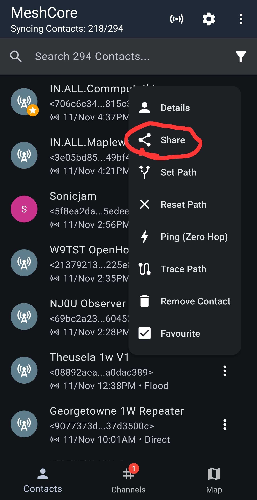<figcaption>Open the repeater's contact menu and select Share.</figcaption></figure>

<figure class="keep-together">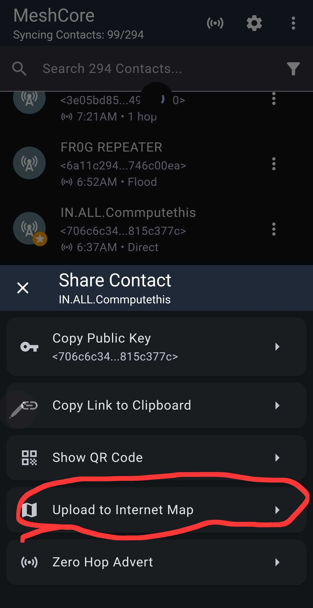<figcaption>Send a Zero Hop Advert, then upload the repeater to the Internet Map.</figcaption></figure>

<div class="page-break" style="page-break-after: always; break-after: page;"></div>

## Final Acceptance Checklist

- [ ] Preclass firmware, configuration, startup test, and temporary-name label confirmed
- [ ] `USA` radio values and 2-byte path-hash mode recorded
- [ ] Temporary standard-form repeater name and owner information recorded
- [ ] Repeater command-line and `us-in` / `nei` / `fwa` region settings confirmed
- [ ] Both PCB traces modified under instructor guidance
- [ ] Corrected JST wiring and solder joints visually verified
- [ ] ALFA antenna and U.FL pigtail secure
- [ ] Battery installed in the labeled orientation only after inspection
- [ ] LoRa relay and charging tests pass
- [ ] TPU gasket and all original hardware installed
- [ ] Antenna joint sealed with self-fusing silicone tape
- [ ] Installed latitude and longitude saved
- [ ] Clock synchronized after the latest reboot
- [ ] Zero Hop Advert sent and repeater uploaded to the Internet Map

## Troubleshooting

| Symptom | Check first |
|---|---|
| XIAO drive does not appear | Double-press `RST` within approximately 0.5 seconds; try another USB data cable or port |
| Flasher cannot connect | Confirm the correct USB device, refresh the browser, reconnect the cable, and retry |
| Settings do not persist | Select **Save settings**, approve the reboot, reconnect, and verify each value |
| No power | Battery orientation, labeled JST connections, switch wiring, solder joints, and CN3065 path |
| No charging | Solar illumination, labeled panel connection, CN3065 connections, and trace cuts |
| Poor LoRa range | Regional preset, ALFA antenna, U.FL seating, height, and obstructions |
| Intermittent operation | Loose connection, weak battery, pinched wire, solder joint, water, or shade |

## Maintenance

Inspect after severe weather and periodically. Clean the panel; inspect the mount, fasteners, gasket, enclosure, and silicone tape; look for corrosion or moisture; review battery performance before winter; and retest after moving the unit or changing its antenna system. After a reboot, run `clock sync`. After moving the repeater, update its coordinates, send another Zero Hop Advert, and upload it to the Internet Map again.

## Build Record

| Item | Record |
|---|---|
| Builder |  |
| Build date |  |
| Repeater name |  |
| Firmware/version |  |
| Preclass board label | Matches / Needs follow-up |
| OTAFIX bootloader and firmware | Prepared / Needs follow-up |
| Radio and region settings | Prepared / Needs follow-up |
| Owner/contact identifier |  |
| Installation location |  |
| Installed latitude / longitude |  |
| Battery installed | Included 1500 mAh 18650 / Other: __________ |
| Final radio test | Pass / Needs follow-up |
| Final charging test | Pass / Needs follow-up |
| Zero Hop Advert / Internet Map | Complete / Needs follow-up |
| Notes |  |

---
