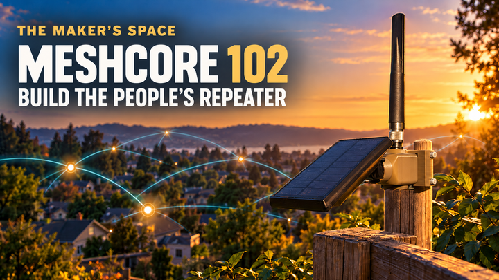

# MeshCore 102: Build The People's Repeater



This repository contains the class materials for the November 2026 Maker's Space workshop. In this two-hour class, participants convert a Harbor Breeze solar-light enclosure into **The People's Repeater**, a solar-powered MeshCore repeater for the 915 MHz band.

The finished unit uses an outdoor antenna and does **not** retain the original light. The class covers repeater placement, a demonstration of firmware and configuration, construction, open-unit testing, weatherproofing, mounting, and maintenance. Each class board is flashed, configured, tested, and labeled before class so approximately 70 minutes can be reserved for the hands-on build.

## Class Recording

A recording of this class is available on YouTube:

[Watch MeshCore 102: The People’s Repeater (coming Soon)](YOUTUBE_URL)

## Project Repository and Build Sources

- Class repository: <https://github.com/commputethis/TheMaker-sSpace_MeshCore102>
- Build reference video 1: <https://www.youtube.com/watch?v=yAmINEghCOc>
- Build reference video 2: <https://www.youtube.com/watch?v=eXMlvGiI7Hs>

The documented build combines ideas from both videos with the class-specific parts, printed components, wiring, firmware preparation, and assembly process.

## Class Materials

| Resource | Purpose |
| --- | --- |
| [Presenter Guide](MeshCore102_PresenterGuide.md) | Instructor preparation, class flow, demonstrations, checkpoints, and troubleshooting guidance |
| [Student Guide](MeshCore102_StudentGuide.md) | Illustrated firmware reference, construction, testing, installation, and maintenance instructions |
| [Presentation](MeshCore102_The_Peoples_Repeater_Slides.pptx) | Editable classroom slide deck |
| [Presenter Guide PDF](pdf/MeshCore102_PresenterGuide.pdf) | Printable presenter reference |
| [Student Guide PDF](pdf/MeshCore102_StudentGuide.pdf) | Printable student handout |
| [Print stylesheet](guide-print.css) | Page and image formatting for converting the Markdown guides to PDF |
| [Images](images/) | Firmware screenshots, parts photographs, build photographs, and finished-unit images |

## What Participants Build

The repeater combines:

- A Harbor Breeze solar-light enclosure and its included 1500 mAh 18650 battery
- A Seeed Studio XIAO nRF52840 with a Wio-SX1262 LoRa radio
- An ACEIRMC CN3065 mini solar LiPo charger
- Three 100 mm female-socket JST PH 2.0 leads
- An ALFA Network AOA-915-5ACM 5 dBi outdoor 915 MHz antenna
- A 6 in / 15 cm U.FL1-to-N-female RG178 pigtail
- A 3D-printed TPU gasket, PETG component mount, and PETG antenna connector clamp
- Waterproof self-fusing silicone tape
- Zip ties or hose clamps for pole mounting

The included 1500 mAh battery is used for the class. A larger compatible 18650 may provide more reserve during cold or low-sun months, but its chemistry, voltage, dimensions, polarity, terminals, protection, and charger compatibility must all match the design.

## Important Build Notes

- Prepare every board before class by updating the bootloader, flashing repeater firmware, applying the class settings, testing startup, and adding a removable label.
- Temporary class names may follow the pattern `IN.ALL.FWA.Class01`, `IN.ALL.FWA.Class02`, and so on. Keep administrator passwords in a secure preparation record rather than on outward-facing labels.
- Leave the small antenna supplied with the Wio attached while the prepared board is handled. Remove it only when the external pigtail is ready to connect during the build.
- Confirm that the solar-light switch is **OFF** before cutting the wire to the light.
- Remove the 18650 immediately after opening the enclosure. Use fingers or a nonconductive tool, never a metal tool.
- Keep the battery out during cutting, desoldering, soldering, and rewiring.
- Visually verify that every connection matches the labels on the hardware and the illustrated build instructions.
- Attach the ALFA antenna before powering or testing the radio.
- Preserve the original enclosure screws and the separate mount screw and nut because they are reused.
- Seat the TPU gasket and rubber switch boot carefully to help keep moisture out.
- Seal the outdoor antenna joint with overlapping self-fusing silicone tape.
- Use zip ties or hose clamps to attach the PETG mount to a pole. They are not needed for internal cable management or strain relief.

## Printed Parts

- [Harbor Breeze solar mesh-node mounts and TPU gasket](https://www.printables.com/model/1748950-26-harbor-breeze-solar-mesh-node-mounts-meshtastic)
- [XIAO nRF52840 and Wio-SX1262 antenna connector clamp](https://www.printables.com/model/1761740-xiao-nrf52840-wio-sx1262-antenna-clamp)

The exact component mount may vary. Confirm that the selected mount fits the enclosure, antenna connector, and other class components before preparing kits.

## Firmware and Configuration References

- [MeshCore Flasher](https://flasher.meshcore.io/)
- [OTAFIX bootloader releases](https://github.com/oltaco/Adafruit_nRF52_Bootloader_OTAFIX/releases)
- [OKI Mesh repeater configuration](https://docs.okimesh.org/books/meshcore-I9o/page/repeater-configuration)
- [Repeater naming standard](https://docs.okimesh.org/books/meshcore-I9o/page/repeater-naming)
- [County abbreviations](https://docs.okimesh.org/books/meshcore-I9o/page/county-abbreviations)

The local naming format is `StateCode.CountyCode.descriptiveName`. For Allen County, Indiana, names begin with `IN.ALL`. The Fort Wayne convention used in the class is `IN.ALL.FWA.descriptiveName`.

Radio, command-line, and region recommendations can change as the local mesh grows. Verify the current NEIMesh recommendations before teaching or deploying a repeater.

## Placement Tools

- [MeshMapper](https://fwa.meshmapper.net/) for coverage purpose and radio-path planning
- [Solar tilt-angle calculator](https://www.baess.app/tools/solar-tilt-angle-calculator) for panel-angle planning

For Indiana, a generally southerly exposure at approximately 40 degrees is a useful starting point. Adjust for site-specific shade, seasonal conditions, safe access, drainage, and the intended coverage area.

## References

The following list collects the web resources used in the guides and presentation. The links also remain next to the relevant instructions.

### Project and Build Sources

- Class repository: <https://github.com/commputethis/TheMaker-sSpace_MeshCore102>
- Build reference video 1: <https://www.youtube.com/watch?v=yAmINEghCOc>
- Build reference video 2: <https://www.youtube.com/watch?v=eXMlvGiI7Hs>

### MeshCore Firmware and Configuration

- MeshCore FAQ: <https://github.com/meshcore-dev/MeshCore/blob/main/docs/faq.md>
- MeshCore Flasher: <https://flasher.meshcore.io/>
- OTAFIX bootloader releases: <https://github.com/oltaco/Adafruit_nRF52_Bootloader_OTAFIX/releases>
- OKI Mesh repeater configuration: <https://docs.okimesh.org/books/meshcore-I9o/page/repeater-configuration>
- Repeater naming standard: <https://docs.okimesh.org/books/meshcore-I9o/page/repeater-naming>
- County abbreviations: <https://docs.okimesh.org/books/meshcore-I9o/page/county-abbreviations>

### Placement and Solar Planning

- MeshMapper: <https://fwa.meshmapper.net/>
- Solar tilt-angle calculator: <https://www.baess.app/tools/solar-tilt-angle-calculator>

### Printed Parts

- Harbor Breeze solar mesh-node mounts and TPU gasket: <https://www.printables.com/model/1748950-26-harbor-breeze-solar-mesh-node-mounts-meshtastic>
- XIAO nRF52840 and Wio-SX1262 antenna connector clamp: <https://www.printables.com/model/1761740-xiao-nrf52840-wio-sx1262-antenna-clamp>

## License

Except where otherwise noted, the original materials in this repository are
licensed under the [Creative Commons Attribution-NonCommercial 4.0 International
License](https://creativecommons.org/licenses/by-nc/4.0/).

You may copy, share, modify, and build upon these materials for noncommercial
purposes. Attribution to the original creator is not required. Please retain a
reference to this license so others understand that commercial use is not
permitted.

Commercial use requires separate permission from the copyright holder.

Third-party trademarks, linked resources, screenshots, printable models, and
other materials identified as belonging to their respective owners are not
covered by this license.

## Repository Layout

```text
.
├── LICENSE
├── MeshCore102_PresenterGuide.md
├── MeshCore102_StudentGuide.md
├── MeshCore102_The_Peoples_Repeater_Slides_v7.pptx
├── guide-print.css
├── images/
│   ├── Build/
│   ├── Parts/
│   └── firmware, parts, and build images
└── pdf/
    ├── MeshCore102_PresenterGuide.pdf
    └── MeshCore102_StudentGuide.pdf
```

The `Build` directory contains the original build-process photographs. The `Parts` directory contains the original component photographs. Images in the root of `images/` are selected, cropped, or labeled versions used by the guides and presentation.

## Updating the Guides

The Markdown files are the editable sources for the printed guides. When exporting them to PDF, use `guide-print.css` with a Markdown-to-PDF workflow that supports custom CSS and HTML page-break elements. Review the resulting page breaks, image sizes, and captions before printing.

When the build process, firmware, local radio settings, or component selection changes, update the Presenter Guide, Student Guide, presentation, and generated PDFs together.
